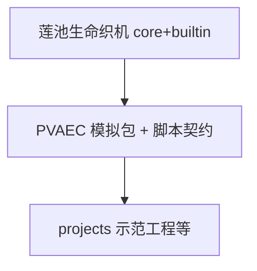

# 莲池生命织机 · VitaLoom + Lotucosm（引擎与编辑器）

> **这是引擎项目。** 织机提供莲池宇宙运行时、`.pond` 场景、插件化编辑器和 SR/PS 播放；**PVAEC AI 模拟**是挂载其上的扩展能力，见 [README_PVAEC.md](README_PVAEC.md)。

仓库总索引：[README.md](README.md)

---

## 项目是什么

**莲池（Lotucosm）** = 宇宙 / 莲池 / 实体 / 组件 / 系统抽象。  
**织机（VitaLoom）** = 基于 PyQt6 的编辑器：场景视口、游戏视口、Dock、包管理、模拟 Transport。

合在一起常称 **莲池生命织机**：用同一仓库做「做游戏、做模拟场景」的**平台**；具体 AI 循环语义由 PVAEC 包与工程脚本提供（PVAEC **不是**具身智能产品，见 [README_PVAEC.md](README_PVAEC.md) 定位说明）。

---

## 快速启动（织机）

```bash
pip install -r requirements.txt
python main.py
```

Windows 也可：`run_editor.bat`  
更短说明：[START_HERE.md](START_HERE.md)、[README_QUICK_START.md](README_QUICK_START.md)

---

## 架构（引擎视角）

```text
main.py
  └─ EditorKernel（织机内核）
        ├─ PluginLoader → builtin/editor_extensions/*_plugin.py
        ├─ SceneManager → projects/*/scenes/*.pond
        └─ GameViewport  → SR tick（2D 场景运行时）

core/Lotucosm/          莲池运行时（与 UI 无关）
core/VitaLoom/         织机框架（视口、Dock、Transport）
builtin/               官方模组（组件 + 编辑器插件 + 莲池系统）
projects/              用户工程（游戏/演示内容，非引擎本体）
plugins/               社区编辑器插件（可选）
```

### 目录说明

| 目录 | 职责 |
|------|------|
| `core/Lotucosm/` | 莲池：`cosmos`、`pond`、`entity`、`component`、`system`、SR 拓扑 |
| `core/VitaLoom/` | 织机：`editor_kernel`、`plugin_loader`、`game_viewport`、`scene_manager` |
| `core/api/`、`core/plugin/` | 扩展 API 与插件接口 |
| `builtin/` | 官方内置：细胞组件、莲池系统、编辑器插件 |
| `projects/` | 工程工作区（见下表「示范工程」） |
| `resources/`、`data/` | 平台资源与编辑器配置 |

子 README：[core/VitaLoom/README.md](core/VitaLoom/README.md)、[core/Lotucosm/README.md](core/Lotucosm/README.md)、[builtin/README.md](builtin/README.md)

### 示范工程（`projects/`）

| 目录 | 用途 | 包依赖 |
|------|------|--------|
| [pvaec-细胞演化](projects/pvaec-细胞演化/) | PVAEC 细胞演化示范（入门 + 挑战） | 含 `vitalloom.pvaec.simulation` |
| [织机教程-迷你Roguelike](projects/织机教程-迷你Roguelike/) | 引擎教学：ScriptBase + 迷你 Roguelike | **不含** PVAEC 包 |

默认打开：File → Open Project → 任选上表工程 → `scenes/*.pond` → ▶。教程说明：[docs/engine_tutorial_roguelike.md](docs/engine_tutorial_roguelike.md)。

---

## 官方包（逻辑拆分）

物理上 `builtin/` 仍是一目录；逻辑上拆为**核心平台包 + 扩展包**，见 [docs/package_architecture.md](docs/package_architecture.md)。

| 包 | 含义 |
|----|------|
| `vitalloom.core.platform` | `core/` 莲池 + 织机（**必装**） |
| `vitalloom.editor_essentials` | 编辑器 UI |
| `vitalloom.lotuspond.runtime` | 莲池组件与系统 |
| `vitalloom.pvaec.simulation` | **PVAEC 研究扩展**（演化/膜/chemo；做游戏教程**不必装**） |
| `vitalloom.engine.sr2d` | 2D 场景播放、**sr_physics2d** 物理、输入、贴图 SR 渲染 |
| `vitalloom.engine.3d` | 规划中 |

**有了核心包 + 所需扩展包 + `projects/` 工程，就能做游戏/演示**；不必把 PVAEC 叙事写进织机内核 README。

---

## 开发约定（织机侧）

| 原则 | 落地 |
|------|------|
| 单 tick 真相源 | SR：`GameViewport`；PS 演示：`builtin/systems/simulation.py` |
| 单播放控制 | `SimulationTransport`；工具栏一个 ▶ + ⏹ |
| 插件只注册 UI | 不在 `plugins/` 复制 SR 聚合或膜拓扑 |
| 关卡不进 `core` | 文案、边权、脚本在 `projects/*` |

---

## 开发迭代

| 改什么 | 怎么做 |
|--------|--------|
| `core/` | 重启编辑器 |
| `builtin/editor_extensions/` | 重启或包管理器重载 |
| `plugins/` | F5 热重载（仅编辑器扩展） |
| `projects/*/scenes`、`scripts` | 保存后停止再 ▶ |

---

## 与 PVAEC 项目的关系



- 改**编辑器、.pond 加载、视口** → 本 README / VitaLoom 文档  
- 改**演化循环、无头实验、受体逻辑** → [README_PVAEC.md](README_PVAEC.md)

---

## 其它指南

- [USER_GUIDE.md](USER_GUIDE.md) — 完整使用与 Mod 编写  
- [PLUGIN_DEVELOPMENT_GUIDE.md](PLUGIN_DEVELOPMENT_GUIDE.md) — 织机插件  
- [ARCHITECTURE_DIAGRAM.txt](ARCHITECTURE_DIAGRAM.txt) — 插件架构图  
- 包管理事务：[docs/package_operation_lifecycle.md](docs/package_operation_lifecycle.md)

## 许可

MIT License（与仓库根 [LICENSE](LICENSE) 一致）
