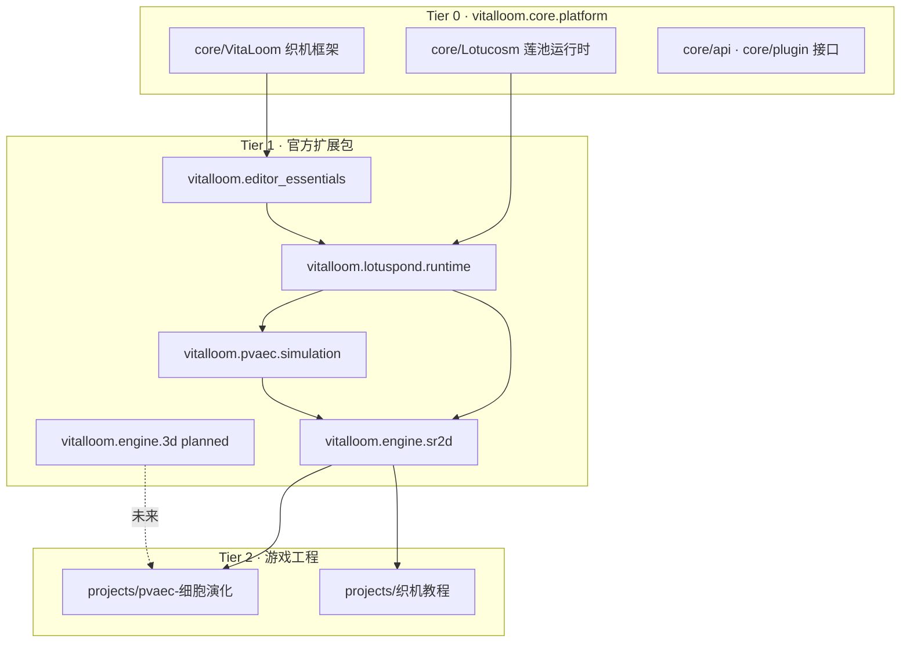

# 莲池织机 · 包体系架构（核心包 + 扩展包）

## 0. 两个项目（读 README 前先分清）

| 项目 | README | 在包体系中的位置 |
|------|--------|------------------|
| **莲池生命织机**（引擎） | [README_VITALOOM.md](../README_VITALOOM.md) | `vitalloom.core.platform`、`editor_essentials`、`lotuspond.runtime`、`engine.sr2d` |
| **PVAEC**（AI 模拟） | [README_PVAEC.md](../README_PVAEC.md) | `vitalloom.pvaec.simulation` + 工程 `scripts/*_pvaec.py` |

单仓索引：[README.md](../README.md)。  
与 [sr_extension_guide.md](sr_extension_guide.md) 配套阅读。

---

## 1. 第一性原理：最小可运行栈

从事实推导，而不是从「Unity 有什么」照搬：

| 必须为真 | 含义 |
|----------|------|
| 有**时间与状态** | 实体、组件、系统、`.pond` 场景 |
| 有**编辑与播放入口** | 织机打开工程、▶ 运行、画布绘制 |
| 有**一条模拟步进** | 单 tick 真相源（SR：`GameViewport`；PS：莲池 `Simulation`） |
| 游戏内容可外置 | 工程 `projects/*` 不写进内核 |

由此得到**唯一分层**：

```text
Tier 0  平台内核 (core/)           → 没有它，织机与莲池都不存在
Tier 1  官方扩展包 (builtin/ 逻辑分包) → 没有它，编辑器与官方细胞能力不全
Tier 2  用户游戏工程 (projects/)   → 没有它，只有空编辑器；有了它才是「游戏」
Tier 3  社区插件 (plugins/)        → 可选，改 UI/工具，不替代 Tier 0 tick
```

**核心包有了就可以做游戏**：指 Tier 0 + 做该类游戏所需的最小 Tier 1 子集 + Tier 2 工程。  
例如主世界 SR 演示 ≈ `core` + `editor_essentials` + `lotuspond` + `pvaec` + `engine.sr2d` + `projects/pvaec-细胞演化`。  
**织机教程（游戏 SR）** ≈ `core` + `editor_essentials` + `lotuspond` + `engine.sr2d` + `projects/织机教程-迷你Roguelike`（**PVAEC 可选**）。

### 教程最小栈

| 包 id | 织机教程是否需要 |
|-------|------------------|
| `vitalloom.core.platform` | 必须 |
| `vitalloom.editor_essentials` | 必须 |
| `vitalloom.lotuspond.runtime` | 必须（实体类型名） |
| `vitalloom.engine.sr2d` | 必须（GameViewport + 瘦 tick） |
| `vitalloom.pvaec.simulation` | **可选**（生态 Dock；教程脚本不用 PvaecScript） |
| `vitalloom.lotuspond.cell` | 可选 |

---

## 2. 奥卡姆剃刀在本架构中的用法

| 原则 | 在本仓库的落地 |
|------|----------------|
| **奥卡姆剃刀** | 假设更少：包管理器只描述**依赖与能力**，不在 `plugins/` 再实现一套 SR tick |
| **KISS** | 当前 `builtin/` **物理仍是一目录**；逻辑分包写在 `package_index.json`，避免大规模搬家 |
| **YAGNI** | `engine.3d` 先登记为 **planned**，不先写空壳 3D 运行时 |
| **SRP** | `core` 不因「主世界关卡文案」而改；关卡只改 `projects/pvaec-细胞演化` |

**允许做的「简单重构」**：文档 + 包索引 + 工程 `recommended_packages` 字段。  
**暂不做的**：把 `builtin/components` 拆到多个磁盘目录（除非包安装器已稳定）。

---

## 3. 命名：莲池 · 织机 · 扩展包

| 中文 | 英文/id | 物理位置 | 职责 |
|------|---------|----------|------|
| **莲池** | Lotucosm | `core/Lotucosm/` | 宇宙/莲池/实体/组件/系统抽象；SR 拓扑、PVAEC 脚本契约 |
| **织机** | VitaLoom | `core/VitaLoom/` | 编辑器内核、Transport、视口框架、插件加载、`.pond` |
| **官方一体模组** | builtin | `builtin/` | 官方细胞组件、莲池系统、编辑器插件（逻辑上拆成多个**扩展包**） |
| **用户工程** | project | `projects/<name>/` | 场景、脚本、资产 = **具体游戏** |
| **社区插件** | community | `plugins/` | 第三方编辑器扩展 |

---

## 4. 官方扩展包一览（逻辑包 → 物理映射）

清单权威来源：[builtin/package_index.json](../builtin/package_index.json)。  
映射说明：[builtin/packages/README.md](../builtin/packages/README.md)。



`engine.sr2d` 直接依赖 `lotuspond.runtime`；主世界额外推荐 `pvaec.simulation`。

### 4.1 `vitalloom.core.platform`（核心包 · 必装）

- **提供**：`core/Lotucosm`、`core/VitaLoom/kernel|simulation|scene|viewports` 框架、`core/plugin`、`core/api`
- **不提供**：具体传感器数值逻辑、主世界关卡、Unity 式全功能编辑器皮肤
- **变更理由**：平台 API、tick 契约、Transport

### 4.2 `vitalloom.editor_essentials`（织机编辑器包）

- **提供**：主题、标准菜单/工具栏、层级/检视器/项目/控制台、场景视口、包管理器、本地化
- **依赖**：`vitalloom.core.platform`
- **变更理由**：编辑器 UX、Dock 布局

### 4.3 `vitalloom.lotuspond.runtime`（莲池运行时包）

- **提供**：`builtin/components/*`、`builtin/entity_types/*`、`builtin/systems`（environment、inheritance、pond 序列化、PS simulation…）
- **依赖**：`vitalloom.editor_essentials`
- **变更理由**：细胞器类型、莲池 PS 演示、组件工厂

### 4.4 `vitalloom.pvaec.simulation`（PVAEC / 神经元模拟包）

- **提供**：`pvaec_orchestrator`、`core/Lotucosm/pvaec_script.py`、生态/模拟控制 Dock、SR 与 PS 的 PVAEC 编排
- **依赖**：`vitalloom.lotuspond.runtime`
- **变更理由**：感知-验证-行动循环、世代/变异策略（非单关卡数值）

主世界 **行为脚本**仍在 `projects/pvaec-细胞演化/scripts/*_pvaec.py`；本包提供**引擎与编排**，不提供「主世界独家剧情」。

### 4.5 `vitalloom.engine.sr2d`（2D 场景运行时包）

- **提供**：`GameViewport` 插件、`SceneViewport`、**`sr_physics2d` 官方 2D 物理**、SR 渲染、`sr_link_physics`、`sr_membrane_topology`
- **依赖**：`vitalloom.lotuspond.runtime`（PVAEC 编排包为可选推荐，见主世界 vs 教程栈）
- **变更理由**：2D 播放、整细胞绘制、硬/软连接

### 4.6 `vitalloom.engine.3d`（3D 引擎包 · 规划中）

- **状态**：`planned`（索引中登记，无额外运行时）
- **未来可能**：`world_viewport` 真 3D、相机、网格物理
- **剃刀**：在需求明确前不实现平行 tick

### 4.7 `vitalloom.lotuspond.cell`（细胞编辑包）

- **提供**：`CellEditor`、`CellSimulation` 插件（PS 细胞内编辑/演示）
- **依赖**：`vitalloom.editor_essentials`
- **与 SR 关系**：主世界 SR **不必须**本包；需要编辑 PS 组件图时安装

---

## 5. 主世界工程需要哪些包？

| 包 id | 主世界 SR 是否需要 |
|-------|-------------------|
| `vitalloom.core.platform` | 必须 |
| `vitalloom.editor_essentials` | 必须（编辑/播放 UI） |
| `vitalloom.lotuspond.runtime` | 必须（实体类型与系统） |
| `vitalloom.pvaec.simulation` | 必须（PVAEC tick 与生态面板） |
| `vitalloom.engine.sr2d` | 必须（游戏视口 SR） |
| `vitalloom.lotuspond.cell` | 可选（细胞内部 PS 编辑） |
| `vitalloom.engine.3d` | 未使用 |

工程内可在 `project.json` 的 `recommended_packages` 记录上述列表（文档用途；安装器逐步消费）。

---

## 6. 与「连接管道 / 组件」的关系

| 能力 | 属于哪一包 |
|------|------------|
| 组件类型 `Sensor`/`Membrane` | `lotuspond.runtime` |
| chemo 边聚合、`link_kind` | `core` + `engine.sr2d`（运行时），场景数据在 **工程** `.pond` |
| `sr_channel_out` 脚本 | **工程** `scripts/*_pvaec.py`（模板见 `projects/pvaec-细胞演化/templates/`） |
| 包管理器 UI | `editor_essentials` |

---

## 7. 扩展新官方包（给维护者）

1. 在 `builtin/package_index.json` 增加条目：`id`、`dependencies`、`provides`、`plugins`。
2. 在 `builtin/packages/README.md` 补一行物理路径映射。
3. **不要**在 `core` 里引用具体游戏工程路径。
4. 社区包放 `plugins/` 或 Registry zip，依赖声明 `vitalloom.core.platform>=1.0.0`。

---

## 8. 相关文档

- [package_operation_lifecycle.md](package_operation_lifecycle.md) — 安装/回滚事务
- [sr_extension_guide.md](sr_extension_guide.md) — 工程内改脚本/场景
- [builtin/README.md](../builtin/README.md) — 官方模组排错
