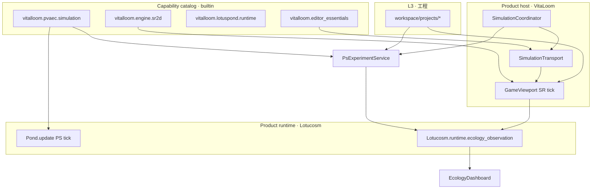

# 莲池织机 · 运行时统一路线图（全引擎 + 官方插件）

本文回答：**SR/PS 双轨道、GameViewport 可视化、工程配置** 如何在「不推翻 v1」前提下**分阶段解决**，并约束 **官方扩展包与社区插件** 的边界。

**架构术语**以 [suite_architecture.md](suite_architecture.md) 为准：
L0 FrameCore、L1 lotucosm-vitaloom 大插件、未单独编号的 versioned runtime boundary、
L2 capability/domain package、L3 engine extension/adapter、L4 project addon/Project World scope。
本文只讨论 `lotucosm-vitaloom` 产品版本内部的 SR/PS 运行时路线；下文 **Tier**
指路线图优先级，不重新定义 Suite 分层。

与 [runtime_entry_points.md](runtime_entry_points.md)（当前入口分工）、[package_architecture.md](package_architecture.md)（包分层）配套阅读。
架构决策记录：[adr/0001-dual-runtime-unification-seam.md](adr/0001-dual-runtime-unification-seam.md)。

---

## 1. 目标与约束

| 目标 | 约束 |
|------|------|
| PVAEC 工程：SR 演示与 PS 扫参**语义一致、指标可比** | v1 不删除 ▶ / Transport 主路径 |
| 织机教程等**无 PVAEC** 工程仍可最小栈运行 | 教程栈可不装 `vitalloom.pvaec.simulation` |
| 社区插件不碰第二套 SR tick | 插件只订阅接缝与 `EditorContext.services` |
| 最终可选：PS 结果在视口**只读叠加**、甚至单 Pond 驱动 | 必须分阶段，禁止一次性 Big Bang |

**行业对照**：Unity 长期保持 Play Mode 与 Batch/Test 分叉；UE 保持 PIE 与 Commandlet 分叉。统一的是**数据契约与工具链**，不一定是**同一帧循环**。

---

## 2. 现状（v1.0 + 回笼后）

| 轨道 | 实体 | tick | 官方包 |
|------|------|------|--------|
| **SR 播放** | `_SceneRuntimeEntity` + `PvaecScript` | `GameViewport._update_scene_runtime_entities` | `engine.sr2d` |
| **PS 批处理** | `Organism` + builtin 组件 | `Pond.update` + Runner | `lotuspond.runtime` + `pvaec.simulation` |

---

## 3. 分阶段路线图

### Phase C.0 — 统一读模型（**已启动**）

**问题**：生态 Dock、状态栏、对比 UI 各读各的字典，插件无法稳定扩展。

**做法**：

| 模块 | 职责 |
|------|------|
| `core/Lotucosm/runtime/ecology_observation.py` | `EcologySnapshot`、`EcologyLane`、`snapshot_from_sr/ps` |
| `core/VitaLoom/simulation/ecology_registry.py` | `collect_ecology_snapshots(editor_context)` |
| 生态 Dock | 只调 registry，不直接摸 GameViewport 字段 |

**官方插件契约**：`EcologyDashboardPlugin`、`SimulationControlPlugin`、`PsExperimentPlugin` 仅依赖 registry + `ps_experiment` / `simulation_transport` 事件。

**验收**：`pytest tests/test_ecology_observation.py`；生态 Dock 行为与改版前一致。

---

### Phase C.1 — 统一配置与工程契约（已实施）

**问题**：SR 用 `.pond` + `mind/evo`；PS 用 `workspace/experiments/*.json`；`mutation_rate` 等参数两处各写各的。

**做法**：

1. 在 `core/Lotucosm/experiment_config.py` 增加与 SR `evo` 对齐的**字段子集**（文档表，非强制同一文件）。
2. `project.json` 扩展（可选）：
   - `evolution_defaults`：SR/PS 共用的数值默认
   - `ps_experiment_preset`（已有）
   - `sr_play_profile`：引用场景或预设名
3. **实验 Dock「工程绑定」** 升级为：写入 `evolution_defaults` + preset 路径（仍不建大型 Project Settings Dock）。
4. `vitalloom.pvaec.simulation` 提供 `load_project_evolution_context(project_path)` 供 Dock/CLI 调用。

**插件**：社区插件只读 `ProjectManager.get_current_project_config()`，不写 tick。

**验收**：改 `project.json` 一处，Dock 与 CLI 读到相同 mutation/interval 默认值。

---

### Phase C.2 — PS 快照视口叠加（骨架已实施；`vitalloom.runtime.replay` 仍为 planned 包）

**问题**：用户要在 GameViewport 里「看到」PS 种群，但不应把 PS tick 塞进 ▶。

**做法**（对标 Unity Test Runner 报告 + Scene 里只看 Gizmo，不跑 Batch 逻辑）：

1. 新官方包 **`vitalloom.runtime.replay`**（planned，见 `package_index.json`）：
   - 插件 `PsReplayOverlayPlugin`（可选，依赖 `pvaec.simulation`）
   - 从 `workspace/state/experiment_runs/<id>/summary.json` + snapshots 读取
   - 在 GameViewport 上绘制**只读 ghost**（半透明点/圈），**不**调用 `Pond.update`
2. `EcologyLane.PS_REPLAY` 接入 registry。
3. Transport **播放时**自动隐藏 overlay，避免与 SR 细胞混淆。

**不做**：PS `Organism` 与 SR 实体一一绑定繁殖（留 Phase C.4）。

**验收**：选历史 run → 视口出现只读分布；▶ 播放时 overlay 关闭或变灰。

---

### Phase C.3 — 模拟协调器（已实施）

**问题**：并行开 SR ▶ 与 PS 实验时，缺少引擎级「会话」概念。

**做法**：

1. L1 VitaLoom：`core/VitaLoom/simulation/simulation_coordinator.py`
   - 注册 `SimulationLane`：`SR_PLAY | PS_BATCH | PS_REPLAY`
   - 查询：`which_lanes_active()`、`can_start_lane(lane)`（策略：默认可并行，工程可禁）
2. `SimulationTransport` 与 `PsExperimentService` 在 start/stop 时通知 coordinator。
3. 状态栏 / 工具栏文案由 coordinator 聚合（仍用 `simulation_transport_state` + `ps_experiment_state`）。

**官方插件**：`StandardUIPlugin` 订阅 coordinator 快照；**禁止**插件直接 `GameViewport.start`。

**验收**：状态栏同时显示 SR 与 PS 状态；工程配置可设 `disallow_parallel_sr_ps: true`。

---

### Phase C.4 — 单 Pond 驱动（真正 Phase C，最后做）

**问题**：两套实体模型导致遗传/适应度无法在同一世界验证。

**做法**（高风险，单独里程碑）：

1. 定义 **`WorldBridge`** 接缝（`core/Lotucosm/runtime/world_bridge.py`）：
   - `sr_entity_to_organism` / `organism_to_sr_display` 仅用于需要统一的工程
2. 可选模式 `project.json` → `"runtime_mode": "unified_pond"`（默认仍为 `dual`）
3. `GameViewport` 在 `unified` 模式下每帧调用**一个** `Pond.step`，SR 脚本改为 Bridge 上的适配器。
4. PS Runner 在 unified 模式下变为「同一 Pond 的快进」，而非第二个 Pond。

**依赖**：C.1 配置统一 + C.2 可视化验证数据一致。

**验收**：`pvaec-细胞演化` 在 unified 模式下 ▶ 繁殖与 PS 批跑 metrics 偏差在文档约定阈值内。

---

## 4. 官方扩展包职责（实施后）

| 包 id | Phase | 新增/变更职责 |
|-------|-------|----------------|
| `vitalloom.core.platform` | C.0 | `lotucosm.runtime.ecology_observation` |
| `vitalloom.engine.sr2d` | C.0–C.4 | SR tick；C.2 提供 overlay 挂载点 |
| `vitalloom.pvaec.simulation` | C.0–C.3 | PS Service、事件、实验 Dock |
| `vitalloom.runtime.replay` | C.2 | planned，PS 快照叠加 |
| `vitalloom.editor_essentials` | C.3 | StandardUI 订阅 coordinator |
| `vitalloom.lotuspond.runtime` | C.4 | Organism / Pond 为统一世界真源 |

---

## 5. 社区插件规则（写入 docs/guides/PLUGIN_DEVELOPMENT_GUIDE）

1. **禁止**在插件内实现 `GameViewport` 级 tick 或第二套 `Pond.update` 循环。
2. **允许**：
   - 订阅 `simulation_transport_state`、`ps_experiment_state`、`ps_experiment_finished`
   - 调用 `collect_ecology_snapshots(editor_context)`
   - 注册 `EditorContext.services` 下的只读或批处理服务（键名带插件前缀，如 `myplugin.metrics`）
3. **需要视口绘制**时：向 `engine.sr2d` 申请 overlay 回调（C.2 后文档化 API），不要 fork `game_viewport.py`。
4. **工程配置**：只通过 `ProjectManager.update_project_config_fields` 写 `project.json` 已文档化字段。

---

## 6. 与「不做项」的关系

| 原「刻意不做」 | 路线图中的解法 |
|----------------|----------------|
| 合并 tick | **C.4 最后做**；C.0–C.3 先统一观测、配置、叠加、会话 |
| GameViewport 画 PS Organism | **C.2 只读 ghost**，不跑 PS 逻辑 |
| 大型 Project Settings Dock | **C.1 工程 JSON + 实验 Dock 绑定**，按字段增长再考虑面板 |

---

## 7. 建议实施顺序（给维护者）

1. ✅ C.0 代码 + 生态 Dock 改用 registry（本仓库已合入时打勾）
2. C.1 `evolution_defaults` + 文档表 + Dock 写回
3. C.2 `vitalloom.runtime.replay` 包索引 + overlay 插件骨架
4. C.3 `SimulationCoordinator` + 工程并行策略
5. C.4 ADR 评审通过后单独立项

---

## 8. 相关文档

- [runtime_entry_points.md](runtime_entry_points.md)
- [experiment_guide.md](experiment_guide.md)
- [pvaec_cell_evolution.md](pvaec_cell_evolution.md) §4 路线图
- [PLUGIN_DEVELOPMENT_GUIDE.md](guides/PLUGIN_DEVELOPMENT_GUIDE.md)

## 2026-07-04 Phase 6C Status Note

Current repository truth is mixed and must be treated carefully:

- A WorldBridge pilot already exists in `core/Lotucosm/runtime/world_bridge.py`.
- GameViewport has opt-in unified bridge hooks behind project `runtime_mode == "unified_pond"`.
- Focused bridge and comparability tests exist and pass in the Phase 6C final audit.
- This does not make unified Pond default-ready.
- The Phase 6C gate passed: `runtime.worldbridge.status`, `tools/check_runtime_worldbridge_status.py`, CLI, and MCP now expose read-only gate evidence. Next gate is Phase 6D mapping-loss audit and smallest safe mapping extension planning.

## 2026-07-05 Phase 6D Status Note

Phase 6D execution material and implementation evidence now exist at `docs/superpowers/plans/2026-07-05-worldbridge-mapping-loss-audit.md` and `docs/mainline_status.md`.

The completed gate is intentionally narrow:

- add a machine-readable mapping-loss audit before larger bridge expansion;
- keep unified Pond opt-in and not default-ready;
- cover `size/radius` as the smallest safe extension because SR `EntityBase` and PS `Organism` already expose those fields;
- keep membrane/component/script mapping out of this phase.

Evidence:

- `tools/check_worldbridge_mapping_audit.py` reports `size_radius: covered`, `lossless: false`, and `default_ready: false`.
- `runtime.worldbridge.mapping_audit`, CLI, and MCP expose the same read-only audit.
- `size/radius` now roundtrips through `world_bridge.py` creation and display sync.

## 2026-07-05 Phase 6E Planning Note

Phase 6E execution material now exists at `docs/superpowers/plans/2026-07-05-worldbridge-component-membrane-decision.md`.

The next gate is a read-only component/membrane mapping decision record:

- identify which PS component facts may be projected as read-only data;
- forbid live behavior mapping such as `update`, `sense`, `process_signal`, `auto_ingest`, `mutate`, and live connection objects;
- expose the decision through tool, Command Registry, CLI, and MCP before any runtime behavior expansion;
- keep `.pond` mutation, GameViewport bridge changes, and component behavior changes out of Phase 6E.

## 2026-07-05 Phase 6E Implementation Note

Phase 6E completed the read-only decision surface:

- `core.Lotucosm.runtime.world_bridge_component_decision.build_worldbridge_component_decision()`
- `tools/check_worldbridge_component_decision.py`
- nested `component_mapping_decision` inside `build_worldbridge_mapping_audit()`
- read-only `runtime.worldbridge.component_decision`
- MCP helper `get_runtime_worldbridge_component_decision()`

The decision remains `read_only_projection_only`. Safe projection candidates are identity/type/location/acquisition/attach/inspectable-property/count fields plus selected membrane/sensor/actuator inspectable fields. Live behavior such as `update`, `sense`, `process_signal`, `auto_ingest`, `mutate`, `add_connection`, and live connection objects remains forbidden for WorldBridge mapping.

This does not approve `.pond` mutation, component graph mapping, unified Pond default-readiness, or SR/PS tick merging.

## 2026-07-05 Phase 6F Implementation Note

Phase 6F adds a read-only component projection prototype:

- `core.Lotucosm.runtime.world_bridge_component_projection.project_worldbridge_component()`
- `core.Lotucosm.runtime.world_bridge_component_projection.build_worldbridge_component_projection()`
- `tools/check_worldbridge_component_projection.py`
- nested `component_projection` inside the WorldBridge mapping audit
- read-only `runtime.worldbridge.component_projection`
- MCP helper `get_runtime_worldbridge_component_projection()`

The projection only reads safe fields already approved by Phase 6E, sanitizes them into JSON evidence, and counts connections without serializing live connection objects. It does not call live behavior methods such as `update`, `sense`, `process_signal`, `auto_ingest`, `mutate`, or `add_connection`.

This still does not approve `.pond` component mutation, live component graph mapping, unified Pond default-readiness, or SR/PS tick merging.

## 2026-07-05 Phase 6G Implementation Note

Phase 6G completed read-only component projection diagnostics:

- `build_worldbridge_component_projection_diagnostics()`
- `tools/check_worldbridge_component_projection_diagnostics.py`
- read-only `runtime.worldbridge.component_projection_diagnostics`
- MCP helper `get_runtime_worldbridge_component_projection_diagnostics()`

Diagnostics summarize projection evidence for tool/UI consumption: component count, coverage by type, safe fields, forbidden behavior, and do-not-claim items. They intentionally omit per-component details and do not implement a UI panel.

Final verification recorded in `docs/mainline_status.md`: projection/diagnostics tests passed, command/CLI/MCP tests passed, projection and diagnostics tools exited 0, `check_core_boundaries.py` passed, `compileall` passed, and `git diff --check` had no whitespace errors.

The next gate is a separate Inspector diagnostics decision so any future UI work stays command-backed and does not create a UI-only behavior path.

## 2026-07-15 Phase 6H Decision Note

Phase 6H approves a later command-backed, read-only Inspector diagnostics foldout with strict scope labeling. The existing diagnostics command is runtime-wide and does not describe the selected entity, so the UI must not interpret `component_count` as selected-entity component state.

The Inspector audit found an existing Command Registry Seam and an existing read-only JSON presentation path. A small Headless import blocker was also removed from `asset_dependency.py` by deferring PyQt-bound ProjectManager/EditorContext imports until their GUI-only methods are called.

No UI was added in Phase 6H. Phase 6I is the unique next Gate. It must introduce a pure diagnostics view-model Adapter, keep the Command Registry as authority, preserve all do-not-claim warnings, and obtain real PyQt6 rendering evidence before claiming Inspector UI completion.

## 2026-07-15 Phase 6I Gates A/B Implementation Note

Phase 6I now has a Qt-free Inspector diagnostics Adapter and a narrow Command Runner Seam in `core.VitaLoom.inspector.worldbridge_diagnostics`.

The Module is deliberately deeper than a UI formatter: one Interface validates Command Registry shape, enforces the read-only/default-not-ready/live-mapping guardrails, rejects component objects and non-JSON values, preserves diagnostic warnings, fixes runtime scope/authority labels, and reduces failures to a deterministic unavailable view-model. The runner calls only `runtime.worldbridge.component_projection_diagnostics` with `{}`.

No Inspector widget code was changed because the current Python 3.13.5 environment has no PyQt6 and the repository `.venv` points to a missing Python 3.11 interpreter. Gates A/B are verified Headless; Phase 6I-C remains the only next Gate and requires a real PyQt6 foldout construction plus widget-tree or screenshot evidence before UI completion can be claimed.

## 2026-07-16 Phase 6I-C UI Integration Note

Phase 6I is now complete. A real PyQt6 Inspector foldout consumes only the Qt-free `WorldBridgeDiagnosticsViewModel` Interface, appears after ordinary selected-object properties, remains absent for no selection, and is collapsed and read-only by default.

The UI Adapter preserves locality: command execution, payload validation, runtime scope, authority labeling, and unavailable-state reduction stay behind `core.VitaLoom.inspector.worldbridge_diagnostics`; the QWidget layer only presents the resulting section. This keeps the Command Registry Seam authoritative and prevents a second UI-only WorldBridge behavior path.

Verification includes real offscreen construction/rendering, single-selection, multi-selection, no-selection, command-failure, read-only, ordering, and test-order isolation proof. The focused Inspector suite passed `27` tests; the combined Phase 6I regression passed `69` tests plus `8` subtests. WorldBridge tools, direct CLI authority smoke, core boundaries, release consistency, and temporary-pycache compileall all passed.

This does not create selected-entity component semantics. The current diagnostics command still has `{}` input and reports runtime-wide projection evidence only. The next Gate must decide whether a selected-entity diagnostics Interface can have a trustworthy authority and stable identifier contract before any implementation is allowed.

**Unique next Gate: Phase 6J — selected-entity WorldBridge diagnostics authority/interface decision.**
## 2026-07-16 Phase 6J Decision Note

Phase 6J found no current command-safe authority for selected live WorldBridge diagnostics. `.pond` provides edit identity (`scene_path + entity_id`) but no live lifetime; `GameViewport.scene_runtime_entities` and `Pond.organisms` own real mutable state but expose private/lifetime-local Implementations; SimulationTransport, SR host, and PS service expose only lane or aggregate data. WorldBridge's `_world_bridge_organism_id` is an optional live-object correlation and the projection diagnostics command remains runtime-wide/static evidence.

The shipped behavior therefore remains **Option A: runtime-wide only**. The approved future direction is **Option C: track-specific read-only Interfaces/Adapters**. The existing `{}` diagnostics command will not accept optional selected identity, and a single cross-track selected command is not approved while SR and PS have different lifetime authorities.

Identity is intentionally separate but optionally correlated:

- `.pond`: `scene_path + entity_id`;
- SR: future `runtime_epoch + runtime_entity_id`, with scene identity only as correlation;
- PS: future `run_id + organism_id`;
- SR↔PS: explicit correlation scoped to both live lifetimes, never unified identity.

The future contract fixes opaque authority-issued lifetime tokens and deterministic `unavailable`, `not_running`, `stale`, `missing`, `unsupported_track`, `invalid_identity`, and `error` states. `stale` precedes `missing`, preventing an old request from resolving a new same-ID object after reload.

Verification: focused Phase 6I/WorldBridge/Inspector regression `38 passed in 3.09s`; projection diagnostics tool, core boundaries, release consistency, and diff check passed. Final worktree audit remained protected at `984` dirty paths.

**Unique next Gate: Phase 6K — SR runtime identity snapshot authority implementation.** It will create the first Qt-free, JSON-only epoch/snapshot authority and narrow GameViewport Adapter. It will not add selected WorldBridge component mapping, Inspector wiring, mutation, `.pond` writes, PS authority, or unified SR/PS identity.

## 2026-07-16 Phase 6K Implementation Note

Phase 6K establishes the first track-specific live identity authority. `SrRuntimeSnapshotAuthority` is Qt-free and owns one opaque SR epoch plus complete copy-isolated JSON snapshots. `GameViewport` remains the mutable runtime owner and acts only as the Adapter that projects a strict scalar whitelist. Reloaded same-ID entities cannot satisfy old identities because epoch mismatch returns `stale` before lookup.

The Adapter begins after coordinator acceptance, preserves identity over ordinary pause/resume, replaces identity on reload, and ends identity on discard/stop. Explicit `.pond` IDs are recorded before runtime bootstrap, so generated entities do not claim serialized counterparts. Publication occurs after the unified bridge tick and on the empty-runtime path, preventing extinct entities from surviving as stale current-epoch snapshots.

No command was added. This is a deliberate depth decision, not an unspecified deferral: the opaque epoch currently has no selected-entity discovery/correlation Interface, so a query command alone would expose an unusable token requirement. The next Gate must first establish a Qt-free selected-SR identity acquisition Adapter; only then may an SR-specific read-only command and selected diagnostics Adapter be evaluated. The runtime-wide `runtime.worldbridge.component_projection_diagnostics` command remains unchanged.

Verification: final combined Phase 6K/GameViewport/Phase 6I regression `79 passed in 1.43s`; core boundaries and release consistency passed; diff check exited 0 with existing line-ending warnings; pre-closure worktree audit was `986`.

**Unique next Gate: Phase 6L — SR selected-identity acquisition and selection-correlation Interface decision/implementation.**

## 2026-07-16 Phase 6L Implementation Note

Phase 6L closes the opaque-epoch discovery gap left by Phase 6K. Editor selection remains heterogeneous and Qt-bound at its source, so `project_editor_selection(...)` acts as the GUI Adapter that emits JSON facts only. The Qt-free `SrSelectedIdentityCorrelation` Module then owns the high-leverage behavior: exactly-one selection validation, canonical scene correlation, active SR context validation, Authority query, explicit prior-identity handling, serialized-counterpart proof, deterministic status envelopes, and copy isolation.

The identity model remains deliberately plural. `.pond` edit identity is `scene_path + entity_id`; SR live identity is `runtime_epoch + entity_id` with scene correlation. The public relation is `scene_correlated_not_unified`. Runtime-created entities cannot be backfilled into edit identity, and reload safety remains epoch-based with stale before missing.

`ISimulationSrHost` was not widened. The selected-identity path has its own `ISrSelectedIdentityHost` Seam and `SR_SELECTED_IDENTITY_HOST` key, giving the architecture a real independent Adapter point without forcing replay/ecology/transport fakes to implement unrelated behavior. `GameViewport` is the runtime Adapter and retains ownership of live state.

The conditional command Gate passed. `runtime.sr.selected_entity_snapshot` can use `{}` because current selection and the active opaque epoch are acquired behind the host Seam; optional explicit identity input exists only for prior-identity/stale queries. It remains read-only, JSON-only, Headless-safe, and separate from the unchanged runtime-wide WorldBridge diagnostics command.

Verification: focused Phase 6L/Phase 6K regression `50 passed in 1.29s`; expanded SR/WorldBridge/Inspector/schema/binding regression `103 passed in 2.27s`; core boundaries and release consistency passed; diff check exited 0 with existing line-ending warnings only; final protected worktree audit was `990`.

This still does not establish a PS run lifetime, cross-track correlation, selected component diagnostics, Inspector selected-entity UI, mutation, `.pond` writeback, or unified Pond default-readiness.

**Unique next Gate: Phase 6M — PS run/organism runtime identity snapshot Authority decision/implementation.** The Gate must audit the real sync/async runner ownership first, then decide or implement an opaque `run_id` and Qt-free organism snapshot Authority without jumping to SR↔PS unification.

## 2026-07-16 Phase 6M Implementation Note

Phase 6M establishes the PS half of track-specific runtime identity without collapsing it into SR identity. `PsRuntimeSnapshotAuthority` is a Qt-free deep Module in the Lotucosm runtime layer. Its Interface owns opaque `ps_<uuid>` lifetime issuance, complete population replacement, strict JSON/copy isolation, revision ordering, stale-before-missing semantics, and worker-safe locking.

The mutable Pond remains the Implementation owner. `PsExperimentRunner` is the narrow Adapter: it projects a fixed organism whitelist, publishes revision 1 after population construction and before tick 1, publishes a complete replacement after every standard or unified-bridge tick, and publishes `[]` after extinction. Finish, cancellation, callback/update failure, and unified-bridge failure end the run in `finally`; persisted summaries are historical only.

`PsExperimentService` now owns one shared Authority for both sync and async execution and exposes only opaque run acquisition plus JSON query methods. Sync errors and worker construction/start/terminal paths close Authority, lane, worker, and state deterministically. Late async callbacks are worker-identity guarded for locality and restart safety.

Verification: focused new/existing suite `48 passed in 0.90s`; expanded PS suite `83 passed in 2.36s`; combined PS + Phase 6K/6L SR/WorldBridge/Inspector suite `125 passed in 4.22s`; core boundaries and release consistency passed; temporary-pycache compileall and final diff/whitespace checks passed; protected audit total `993` (`+3` new tests from the Phase 6L baseline).

Phase 6M does not add PS selection, a command Host, cross-track identity, component mapping, mutation, `.pond` writeback, tick merge, or default-ready acceleration claims.

**Unique next Gate: Phase 6N — PS runtime organism snapshot Host/Command discovery Interface decision/implementation.** The Gate must first audit how an AI/Headless caller can discover an active run and organism ID without importing the PyQt-bound service or fabricating selection semantics; it may implement a read-only command only if that discovery is truthful.

## 2026-07-16 Phase 6N Implementation Note

Phase 6N closes the PS opaque-identity acquisition gap without inventing PS selection semantics. `PsRuntimeSnapshotAuthority.discover()` is the sole discovery Authority because its complete replacement table is the only current source of organism IDs after reproduction, removal, or extinction. Discovery atomically returns the active run, revision, exact count, and sorted full identities; an active empty population remains distinct from no active run.

The Qt-bound experiment Service exposes only a narrow discovery/query source Interface. The Qt-free `IPsRuntimeSnapshotHost` Seam owns context lookup, Headless fallback, strict JSON-object validation, and copy isolation. Its editor Service-backed Adapter and deterministic null Adapter satisfy the deletion test: without the Module, Command handlers and future callers would each need to understand PyQt lifecycle, Service registration, unavailable behavior, and identity acquisition rules.

Two read-only commands now share this Interface. `runtime.ps.organism_discovery` accepts `{}` only to discover the current run and identities. `runtime.ps.organism_snapshot` requires a full `ps_batch + run_id + organism_id` identity; empty payloads and bare organism IDs cannot guess selection. Standalone CLI/MCP correctly return `unavailable` because they cannot inspect another process's editor worker.

A combined regression exposed and fixed a real Headless lifecycle defect: creating `EditorContext` during Host lookup without `QApplication` left a half-initialized QObject singleton that later broke panel construction. `get_existing_editor_context()` now performs non-creating lookup.

Verification: focused implementation `39 passed in 0.71s`; Headless singleton plus panel smoke `15 passed in 0.60s`; broad PS/SR/Command/CLI/MCP `133 passed, 8 subtests passed in 8.94s`; Phase 6K/6L/6N plus Inspector/WorldBridge `146 passed in 2.95s`; final targeted composition `80 passed in 1.62s`. Core boundaries, release consistency, Python syntax, strict UTF-8/replacement-character/literal-newline checks, scoped new-code whitespace checks, and diff checks passed. Pre-existing space-only docstring lines in `editor_context.py` were preserved; final protected audit total is `995`.

Phase 6N does not add PS selection, cross-track identity, selected WorldBridge component state, mutation, `.pond` writeback, SR/PS tick merge, unified Pond default-readiness, native completion, or OpenGL default-readiness.

**Unique next Gate: Phase 6O — track-specific runtime snapshot WorldBridge component projection mapping Authority decision/implementation.** The Gate must first audit the SR and PS runtime snapshot whitelists against the existing WorldBridge component decision/projection vocabulary and identify a truthful source Authority. It must remain decision-only if live/lossless mapping cannot be proven.

## 2026-07-16 Phase 6O Implementation Note

Phase 6O proves a truthful but deliberately non-lossless path from current track Authorities to WorldBridge component vocabulary. A new Qt-free Mapping-only Module projects strict snapshot facts rather than live objects. Successful legacy snapshots without facts report `not_proven`, never authoritative zero.

The PS Adapter reads a fixed whitelist from `organism.components`, invokes no behavior, and exposes connection counts only. The SR Adapter maps only attachment-proven sensor/actuator runtime entities and explicitly rejects PS Component equivalence. Two track-specific read-only commands and MCP helpers reuse the existing PS and SR Host Seams; no PS selection or unified identity was invented.

Verification closed at `172 passed in 13.55s`, with core boundaries and release consistency passing and protected worktree total `997`.

**Unique next Gate: Phase 6P - command-backed SR selected-entity component projection Inspector integration decision/implementation.**

## 2026-07-16 Phase 6P Implementation Note

Phase 6P connects the selected-SR runtime component projection to the Inspector without collapsing distinct Authorities. A new Qt-free presentation Module validates Command Registry envelopes, JSON-only values, SR track/scope/relation guardrails, status-correlated snapshot-fact evidence, identity/revision/count/coverage consistency, unique components, and copy isolation. Deleting it would scatter those semantics across Qt code, so the Module earns locality and leverage.

The UI remains a thin Adapter. Exactly one selection receives a separate, collapsed, read-only `WorldBridge Components (Selected SR Runtime Entity)` foldout. Multiple selection does not invoke selected-SR authority. Ordinary properties remain intact on unavailable/error states, and runtime-wide diagnostics remain a separate foldout. `not_proven` is unknown, never zero; attachment projection is explicitly not PS Component equivalence.

Verification includes real offscreen PyQt show/expand/process-events/non-null-grab evidence, focused `58 passed in 1.11s`, broad `197 passed in 10.77s`, core/GUI boundary checks, release consistency, syntax/import smoke, and diff checks. Protected worktree total is `999`, net `+2` from Phase 6O.

**Unique next Gate: Phase 7 - asset database, export, and project-scale baseline/Authority decision.**

## 2026-07-16 Phase 7 Asset Index Authority Note

Phase 7 replaced repeated asset/dependency/export scans with one Qt-free immutable project asset-index Module. Commands, legacy editor dependency display, reference lookup, and real Player export now share deterministic project-relative identity, content digests, dependency pointers/status, malformed-scene truth, provenance correlation, and export readiness. Existing project-external files can no longer make a non-reproducible export appear ready.

The project-scale baseline is 1,000 assets / 1,021 files / 400 edges: cold build `4,146.483 ms`, same-content full rebuild `891.873 ms`, projection `0.309 ms`. This is not an incremental-cache claim.

**Unique next Gate: Phase 7B — persistent asset identity, mutation refresh, and incremental index/cache Authority.**

## Phase 7B Implementation Note (2026-07-16)

Phase 7B closes the persistent identity/mutation-refresh boundary without conflating it with the Phase 7 current-facts Index. `asset_registry.py` persists opaque IDs, active entries, tombstones, revisions/generations, metadata digest-cache entries, and recovery diagnostics in project-local JSON at `<project>/.vitaloom/asset_registry.json`. It performs atomic replacement, keeps the ID across content changes and explicit renames, creates a new ID for same-path/different-content recreation, recognizes an external rename only when the SHA-256 match is unique, and reports duplicate-content ambiguity instead of guessing. The Registry-supported projection is parity-checked against full Index facts.

The mutation surface now has explicit `asset.refresh`, `asset.rename`, and `asset.delete` commands; `asset.create` and `asset.import` refresh and return additive identity metadata; project open, library import/delete, and external image drop converge through that seam. `asset.scan` remains pure read. The 1,000-asset scale case measured a 713.6772 ms unchanged refresh with 1,021 metadata-cache hits and a 648.9053 ms one-file refresh with 1,020 hits/1 miss; this is no watcher/hot-reload or byte-proof claim.

**Unique next Gate: Phase 7C — dependency-aware asset rename/delete reference migration and undo Authority.** Before implementation, audit and plan `.pond` JSON-pointer rewrites, missing-reference diagnostics, inverse transactions/undo, cross-file atomicity/recovery, folder semantics, and export implications.

## 2026-07-16 Phase 7C Asset Reference Transaction Authority Note

Phase 7C closes the reference-safe mutation seam without conflating current asset facts, persistent identity, and transaction recovery. `asset_reference_transaction.py` is a deep Qt-free Module: it consumes the Asset Index canonical resolver and Asset Registry verified hints, but owns structured reference locations, impact plans, owner-file atomic writes, private journals/backups, compensation, guarded undo/redo, and recovery-required diagnostics. The commands `asset.rename`/`asset.delete` are thin Adapters; `asset.transaction.undo`/`redo`, generic undo/redo, and durable project replay use the same receipt.

Rename updates canonical matches only, including `project.json.active_scene` and representable script shorthand, while preserving relative writing style. Referenced delete remains an explicit hard block; unreferenced single-file delete has private backup/tombstone/guarded identity restoration. Project open only reports incomplete journals; it never guesses and overwrites project files. Private transaction artifacts are outside Index/export/Player truth.

Verification: 95 relevant tests passed in 43.20 s, plus 57 focused transaction/command/CLI/MCP/tools tests in 40.94 s. Core/GUI/release/import/diff gates passed. A synthetic 1,000-asset/20-scene/400-edge transaction case measured rename plan/apply/undo/redo at 906.2123/5800.7294/807.7566/700.5388 ms and unreferenced delete plan/apply/undo/redo at 936.2825/1847.7726/1006.6926/1107.6256 ms; export stayed ready after redo and transaction metadata was not exported.

**Unique next Gate: Phase 7D — asset transaction recovery resolution and operator-control Authority.** It must make incomplete/failed journal state, legal guarded actions, and operator-visible recovery facts explicit without adding automatic recovery, referenced-delete migration, recursive folders, watchers, or cross-process locking.

## 2026-07-16 Phase 7D Implementation Note

Phase 7D is complete. Asset transactions now have a single Qt-free, digest-grounded recovery Authority rather than a project-open list of opaque journal paths. Inspection/listing reports deterministic classification, file facts, affected paths, legal actions, and conflicts; project open is still read-only. The only implemented recovery resolutions are receipt-only `rollback` from proven before-state `prepared`/`redoing` journals and receipt-only `acknowledge_failure` from proven compensated before-state journals. Anything malformed, unknown, mixed, or user-modified is a refusal. No `resume`, inferred applied state, automatic recovery, or cleanup is claimed.

`asset.transaction.inspect`, `asset.transaction.recovery.list`, and `asset.transaction.recovery.resolve` expose the same Module contract to command, CLI, and MCP. Delete redo now refuses a changed private backup before overwriting it. The relevant regression suite passed **107 tests in 52.88 s**; boundary/release/import/diff checks passed; the 1,000-asset transaction benchmark remained export-ready after redo with transaction metadata excluded.

**Unique next Gate: Phase 7E ? referenced-asset retirement/replacement policy and Authority decision.** It must retain the current hard block for live references and first produce only a deterministic read-only policy/impact analysis before any replacement mutation is considered.

## 2026-07-17 Phase 7E Referenced-Asset Retirement Policy Authority Note

Phase 7E completes the decision seam without weakening Phase 7C's referenced-delete block. `analyze_asset_retirement_policy(project_root, *, source_path, replacement_path=None)` is a deep, Qt-free read-only Module in `asset_reference_transaction.py`: it concentrates retirement eligibility, canonical reference impact, representability, refusal reasons, and current Asset Index/Registry facts behind one JSON-only interface. Its callers do not parse `.pond`, infer removal values, or build a second registry/dependency view.

The only positive result is a `replacement_candidate`, and that result is deliberately not a receipt, mutation permission, or plan durable enough to apply later. It proves only that the current project facts are suitable for a *future* separately revalidated operation: project-contained unprotected files, source/replacement distinction, no malformed owners, and every live canonical location expressible through the existing style-preserving helper. Remove-without-replacement, malformed owners, unsupported script shorthand, and invalid target facts remain explicit refusals. Unreferenced files merely report that the existing `asset.delete` route is available.

`asset.retirement.analyze` exposes that same Module through the Command Registry as a non-mutating Adapter, so CLI/MCP discovery gains no alternate mutation path. Direct/command byte parity, existing Registry/Index/export parity, deterministic 1,000-asset scale evidence, and the old `asset.delete` hard-block are covered. The remaining Player smoke rerun is environment-limited because the active Python 3.13 lacks PyQt6; no Player behavior changed.

**Unique next Gate: Phase 7F ? referenced single-file asset replacement transaction Authority.** It must start with a written plan and red tests, must freshly revalidate all candidate facts at apply time, and must separately prove source-byte/tombstone disposition, atomic owner/asset/Registry effects, conflict guards, undo/redo/recovery, and export parity. It must not smuggle in remove-only, folders, UI, watcher/hot reload, or cross-process behavior.

## 2026-07-17 ? Phase 7F status: referenced single-file asset replacement transaction Authority

Phase 7F is complete. The plugin-shaped runtime now has one explicit, guarded `replace_referenced` transaction operation. It retains the existing Authority boundary: only project-contained, existing, non-protected, distinct single-file source/replacement pairs are eligible; apply freshly revalidates current source/replacement/owner/reference/Registry facts before writes; exact representable canonical references are rewritten with style preservation; the source is privately backed up, unlinked, and tombstoned; and replacement bytes/identity are immutable transaction facts.

Receipt recovery, in-memory undo/redo, and durable project audit replay all cover the operation. The command adapter is discoverable through the existing command registry, CLI, and MCP, but it intentionally reports that semantic compatibility is not inferred. Focused tests passed (`63 passed in 11.07s`), boundary/release checks and temporary-pycache compilation passed, and the 1,000 asset / 20 scene / 400 edge benchmark recorded the replacement lifecycle evidence. The only outstanding evidence limitation is environmental: Python 3.13 lacks PyQt6, causing Player-shell import failure after export creation; product code and tests were not changed to hide it.

This did **not** introduce a UI flow, replacement creation/copy/import, folders, remove-only behavior, semantic conversion, watcher/hot reload/background indexing, cross-process locking, generic filesystem undo, native acceleration completion, or OpenGL default readiness. Referenced `asset.delete` remains hard-blocked.

**Unique next Gate: Phase 7G ? strict durable asset transaction receipt validation.**

## 2026-07-17 - Phase 7G status: strict durable asset transaction receipt validation

Phase 7G is complete. The transaction Authority now treats durable journal content as untrusted input at every consumer boundary. A strict shared validator checks schema-1 structure, id/state/operation coherence, canonical project paths and SHA-256 values, operation-specific target/backup facts, Registry revision digests, exact owner file records, canonical base64, and payload digest parity. The reader refuses invalid receipts before undo, redo, resolution, or durable replay can reach a write-capable action; recovery inspection/listing retain deterministic read-only malformed/unknown/unsupported classifications and leave operator evidence intact.

The focused proof set passed (69 passed in 15.82s), including byte-snapshot no-write cases for corrupted root/JSON/id/path/digest/state/backup/file-record/base64/target data. Core/GUI/release checks and temporary-pycache compilation passed. Player smoke remains environment-limited on July 17, 2026 because Python 3.13 lacks PyQt6 after export creation; code and tests were not changed to hide it.

This did not add journal repair/deletion, retention cleanup, a UI flow, additional operations, folders/import/copy/remove-only behavior, watcher/hot reload, cross-process locks, semantic conversion, generic filesystem undo, native completion, or OpenGL default readiness.

**Unique next Gate: Phase 7H - durable asset transaction retention and operator-controlled pruning policy Authority.**

## 2026-07-17 - Phase 7H status: durable transaction retention policy Authority

Phase 7H is complete. The transaction module now offers a single JSON-only retention-policy inventory that reuses strict receipt inspection and never mutates the transaction root. It lists journals, private backups, and unknown artifacts in deterministic project-relative order; explains protected, retained, or not_prunable status; and explicitly refuses to infer a safe prune candidate from terminal state, age, filename, or missing visible backup. Recovery-required/malformed/conflicted evidence is protected, valid lifecycle evidence is retained, and orphan/unknown files are not prunable until provenance and operator intent are proven.

The non-mutating asset.transaction.retention.analyze adapter preserves the Command Registry/CLI/MCP architecture without opening an alternate cleanup path. Focused proof passed (74 passed in 16.84s), boundary/release checks and temporary-pycache compilation passed. Player smoke remains environment-limited on July 17, 2026 because the current Python 3.13 has no PyQt6 after export creation; no code/test masking was introduced.

This did not delete, compact, repair, or automatically clean artifacts, and did not add UI, additional asset operations, folders/import/copy/remove-only behavior, watcher/hot reload, locks, semantic conversion, generic filesystem undo, native completion, or OpenGL default readiness.

**Unique next Gate: Phase 7I - explicit operator-confirmed durable transaction artifact prune execution Authority.**

## 2026-07-17 - Phase 7I status: explicit operator-confirmed durable transaction artifact prune execution Authority

Phase 7I is complete. The transaction module now has one deliberately narrow, Qt-free irreversible prune Authority. It deletes only an operator-named complete journal/private-backup bundle after strict receipt, digest, policy, provenance and confirmation revalidation; it stages first, compensates or exposes only explicit receipt-scoped recovery, and never reaches source assets, scene owners, Index/Registry or export state. An authentic terminal prune receipt is the explicit durable undo/redo revocation boundary.

The phase also closes the command-audit namespace split-brain: `.vitaloom/command_audit.jsonl` is the only new write target; `.vitalloom/command_audit.jsonl` is legacy read-only compatibility. Deterministic merge/de-duplication and strict malformed/conflict refusal ensure old or damaged audit data cannot become irreversible-prune provenance.

Focused proof passed (29 passed in 5.11s; audit/replay/CLI-MCP discovery 16 passed in 1.42s). Expanded Qt-free core proof passed (137 passed in 24.82s), plugin non-GUI proof passed (46 passed, 1 deselected in 4.82s), and core/GUI/release checks plus external-cache compileall and 302-file memory syntax verification passed. Active Python 3.13.5 still lacks PyQt6, so GUI/Player/full CLI-MCP evidence remains environment-limited and was not masked.

This did not add automatic/bulk/age-based cleanup, a cleanup UI, folders/import/copy/remove-only behavior, watcher/hot reload/background indexing, cross-process locking, generic filesystem undo, semantic conversion, native completion or OpenGL default readiness.

**Unique next Gate: Phase 7J - durable asset-transaction mutation cross-process interlock Authority.**
