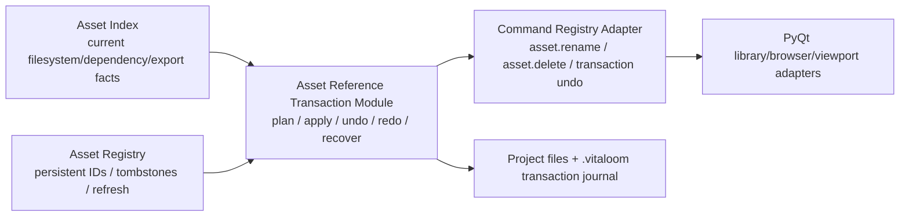

# Phase 7C 鈥?Dependency-Aware Asset Reference Migration and Undo Authority

**Date:** 2026-07-16  

**Status:** complete  

**Previous Gate:** Phase 7B 鈥?persistent asset identity, mutation refresh, and incremental cache Authority  

**Architecture focus:** establish one Qt-free transaction Module that owns canonical reference-impact planning, reversible project-file mutation, recovery evidence, and Registry continuity for asset rename/delete. It must consume, not duplicate, the Phase 7 Asset Index current-facts Authority and Phase 7B Asset Registry identity Authority.

## 1. Gate objective

Phase 7B deliberately limited `asset.rename` and `asset.delete` to file-system mutation plus Registry refresh. That preserved stable identity/tombstones but intentionally left `.pond` references unchanged. The current behavior can therefore leave a project export-unready after a rename/delete even when the operation command itself returned success. This Gate makes that impact explicit and transactional.

The Gate introduces one deep Qt-free Module:

```text
core/VitaLoom/project/asset_reference_transaction.py
```

Its small Interface must separate discovery from mutation:

```python
plan_asset_reference_mutation(project_root, *, operation, source_path, target_path=None)
apply_asset_reference_mutation(project_root, plan)
undo_asset_reference_mutation(project_root, transaction_id)
redo_asset_reference_mutation(project_root, transaction_id)
recover_asset_reference_mutations(project_root)
```

Callers receive a JSON-only plan/receipt: canonical source/target, writable reference edits, non-rewritable references, blocking diagnostics, affected files, Registry identity expectations, transaction ID, and pre/post revision/digest evidence. No Qt object, ProjectManager, Command Registry object, or hidden editor global may enter the Module.

## 2. Starting audit facts

1. `asset_index.py` already discovers project references across `project.json.active_scene`, `.pond` fields in `PATH_KEYS` or `*_path`, and special `scripts` entries. It emits human-readable diagnostic paths such as `$.entities[0].sprite_path`; those are **not RFC 6901 JSON Pointers and cannot be used as a write locator**. The transaction Module therefore needs structured traversal tokens plus a stable diagnostic string; it must not parse the current display pointer back into writes.

2. Resolution is semantic, not string equality: a path can resolve project-relative or scene-relative depending on the pre-mutation filesystem. Rewrite eligibility must use the same pre-mutation resolution rules and canonical target truth as the Index.

3. `scripts` has three source forms: mapping `path`, mapping `name`, and bare string. `name`/bare forms imply `scripts/<name>.py`; they can only be rewritten automatically when the destination stays under `scripts/` and the shorthand remains representable. Otherwise the plan must report `non_rewritable_reference` and block a rewrite-required rename rather than fabricate a path.

4. Current `asset.rename` uses `Path.replace` and a Registry rename hint; `asset.delete` unlinks a single file and tombstones it. Neither command is declared undoable. Folder-recursive mutation remains unsupported and must remain out of scope.

5. CommandRegistry undo/redo is currently command-payload replay, while durable project undo recognizes only `entity.create`, `transform.set`, and `script.set_property`. A file/reference transaction needs a durable receipt/journal plus compare-before-restore guards; extending the whitelist without a receipt would be unsafe.

6. The older `asset_dependency.py` facade still has a separate recursive reference walk for UI compatibility. It must become an Adapter over canonical Index/transaction impact evidence during this Gate; a second mutation scanner would harm locality and drift from export truth.

## 3. Authority and transaction decision



- **Asset Index stays read-only Authority.** The transaction Module may share its path-resolution/traversal semantics through a narrowly extracted pure helper only if tests prove parity; it must not make the Index write files.

- **Asset Registry stays identity Authority.** Rename apply/undo passes explicit directional rename hints. Delete undo requires a Registry restore hint that may reactivate only the matching tombstone ID when its retained digest/path proof matches; arbitrary caller-supplied ID resurrection is forbidden.

- **Transaction Module earns depth.** Deleting it would force every Command/UI caller to decide eligibility, scene-relative formatting, JSON edit locations, staging, compensation, journal format, Registry refresh direction, and undo conflict protection. It centralizes that complexity behind one Interface, improving locality and leverage.

- **Journal location:** `<project>/.vitaloom/asset_transactions/<transaction_id>.json` plus a transaction-private backup directory for bytes that must survive a delete undo. The files are neither inventory nor export payload. Journal state is durable and explicit: `prepared`, `applying`, `applied`, `undoing`, `undone`, `redoing`, `failed_recoverable`.

- **Atomicity contract:** cross-file filesystem operations are not globally atomic. Before the first visible mutation, write and fsync the prepared journal and stage complete JSON replacements in same-directory temporary files. Apply uses deterministic ordering, atomic per-file replacement, and compensating rollback from verified pre-images on an in-process failure. On project open/recovery, incomplete journals are inspected and either safely completed/rolled back only when digest guards match or surfaced as `asset_transaction_recovery_required`; they are never silently guessed away.

- **Conflict contract:** undo/redo never overwrites a scene, manifest, or asset whose current digest differs from the receipt鈥檚 expected before/after digest. It returns a structured `asset_transaction_conflict` diagnostic and leaves the journal recoverable.

## 4. Operation policy for the first vertical slice

### 4.1 Rename

- Support one contained file only, retaining Phase 7B protected-path and destination-parent rules.

- A plan finds every canonical reference whose resolved target equals the source before the rename. It rewrites project-relative and scene-relative `PATH_KEYS`/`*_path` forms while preserving a representable reference style; it rewrites `project.json.active_scene` when a `.pond` scene moves; it treats script shorthand using the explicit audit rule above.

- Default command behavior becomes **plan then apply**. A rename with any non-rewritable reference is blocked before file mutation, unless a future explicitly planned policy supplies a replacement mapping. A successful receipt lists all rewritten fields and the preserved `asset_id`.

- Undo reverses source/target, restores exact pre-images, and preserves the same Registry ID via reverse hint. Redo re-applies only when its post-undo digest guards match.

### 4.2 Delete

- Support one contained file only. It first produces a reference-impact plan.

- In the first vertical slice, delete is **blocked when live references exist**; it never turns references into missing strings, silently removes fields, or invents a replacement asset. An unreferenced delete is applied through the transaction journal, stores a private backup, tombstones the Registry entry, and supports guarded undo/redo.

- The explicit `blocked_references` receipt uses the same canonical facts as export readiness. A later Gate may design replacement/removal migration only after a separate user-visible policy and schema audit.

## 5. TDD implementation sequence

1. **Red discovery tests:** multi-scene project-relative and scene-relative asset paths, duplicate locations, nested lists/maps, active-scene rename, script path/name/bare forms, malformed `.pond`, outside/missing paths, and diagnostic-token stability. Establish parity with Index edge targets/statuses without relying on the legacy display pointer as a locator.

2. **Pure planning Module:** implement JSON traversal with structured location tokens, canonical pre-mutation resolver, per-file edit plan, safe replacement formatter, non-rewritable/blocking diagnostics, and deterministic plan revision. Add an Adapter test proving `asset_dependency.py` reference display comes from the canonical plan/Index facts rather than its own recursion.

3. **Transaction journal and recovery red tests:** preparation before mutation, staged files, injected mid-apply failure with compensating restore, interrupted-journal recovery, journal isolation from Index/export, and digest-guarded conflict refusal.

4. **Rename vertical slice:** route `asset.rename` through plan/apply, update command schema/output/events, Registry directional hints, project-open recovery Adapter, and command/UI tests. Add in-memory and durable `command.undo`/`command.redo` records only after the transaction receipt can prove reversal.

5. **Unreferenced delete vertical slice:** route `asset.delete` through plan/apply, create/recover private byte backup, add guarded undo/redo plus Registry tombstone restoration, and retain the hard block for referenced deletion.

6. **Verification/closure:** regression suite for Index/Registry/command/undo/CLI/MCP/export/project-open, injected failure/recovery tests, boundary/release checks, project-scale impact benchmark, diff check, then update mainline status/roadmap/index/handoff prompt and name exactly one next Gate.

## 6. Required invariants

- Do not change `.pond` schema, manifest schema, package/version layout, Player export payload, or the distinction among missing, invalid, malformed, and outside-project references.

- No watcher, hot reload, background processing, cross-process lock, folder recursion, or generic global undo claim.

- A failed or conflicted transaction must leave export truth derived from current files; it must never report references rewritten when their digest-guarded write did not complete.

- Registry revision/generation, asset ID, transaction ID, affected paths, and recovery status must be explicit JSON facts鈥攏ot hidden UI state.

- Existing Phase 7B `asset.scan` stays pure read and does not create a Registry or transaction journal.

## 7. Verification matrix

| Claim | Required proof |
| --- | --- |
| canonical discovery | Index target/status parity across project-relative, scene-relative, active-scene, and scripts forms |
| safe write locations | structured token tests rewrite exactly one intended JSON value and preserve all unrelated data |
| rename migration | multi-scene references + project active scene rewrite; persistent Registry ID unchanged |
| delete safety | referenced delete blocks with deterministic impact; unreferenced delete tombstones and is undoable |
| undo/redo | in-memory and durable replay restore bytes/references/identity only when digest guards match |
| failure/recovery | injected failure compensates; interrupted journal recovers or explicitly reports a conflict |
| isolation | journals/backups absent from Index inventory/export closure/Player payload |
| architecture | transaction Module has no PyQt/ProjectManager/editor-global/CommandRegistry imports; legacy facade is Adapter-only |
| scale | reference-impact plan and one-file transaction timings reported separately from Index/Registry refresh |

## 8. Explicit deferrals

- Referenced-delete replacement/removal migration, user conflict-resolution UI, and recursive folder mutation.

- Cross-process locking, file watchers, importer daemon, hot reload, and background indexing.

- Generic undo for arbitrary external filesystem edits or all historical command types.

- Any Unity/Godot/Electron migration, OpenGL default-readiness claim, or native acceleration completion.

## 9. Completion record

Completed on 2026-07-16. The Qt-free `asset_reference_transaction.py` Module now owns structured reference-impact plans, atomic owner-file replacement, durable journal/backup receipts, guarded undo/redo, compensation after injected apply failures, and explicit incomplete-journal diagnostics. Rename preserves Registry identity through directional hints; unreferenced delete creates a backup/tombstone and restores the same identity only through verified tombstone restore hints. The command Adapter routes `asset.rename`/`asset.delete` through this Module and adds `asset.transaction.undo`/`asset.transaction.redo`.

Verification on 2026-07-16: the Phase 7C targeted suite passed **95 tests in 43.20 s**; the focused transaction/command/CLI/MCP/tools collection passed **57 tests in 40.94 s**. `tools/check_core_boundaries.py`, `tools/check_gui_boundaries.py`, `tools/check_release_consistency.py`, runtime import smoke, and `git diff --check` all passed. The 1,000-asset transaction scale case reported one rename edit, zero delete edits, export ready after redo, and transaction metadata absent from export.

## 10. Unique next Gate

**Phase 7D — asset transaction recovery resolution and operator-control Authority.**

